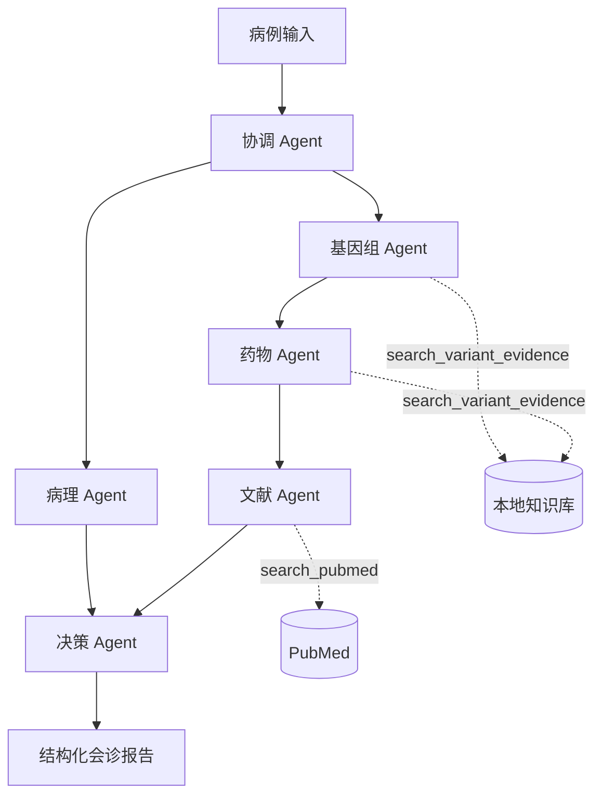

# 医学多智能体系统：模拟 MDT 多学科会诊

基于 LangGraph 构建的多智能体协作系统。输入一份带基因检测结果的虚拟肿瘤病例，系统由 6 个角色 Agent 分工完成基因组解读、病理结构化、药物匹配、文献检索与综合决策，输出一份**每个结论都可溯源**的结构化会诊报告。

> 本项目为生物医学信息学课程设计，全部病例由公开数据构造，不含任何真实患者信息，**不构成医疗建议**。

## 课程五环节对应

| 环节 | 本项目做了什么 |
|---|---|
| **Problem** | 肿瘤 MDT 会诊中，基因、病理、药学、文献信息分散在不同科室，人工整合耗时且难以复核 |
| **Data** | 知识库 77 条「变异—药物—证据等级」记录；10 份虚拟病例（8 份有药可用 + 2 份无靶向药负样本） |
| **Model** | 6 个 Agent 组成的 StateGraph，含 1 条并行分支；LLM 通过 function calling 调用本地知识库与 PubMed |
| **Benchmark** | 三组对比（完整多 Agent / 单 Agent 基线 / 去掉文献 Agent）× 10 病例 × 3 次重复，共 90 次运行 |
| **Biological interpretation** | 每条推荐输出「突变 → 通路 → 药物机制」解释链，并附带真实 PMID |

## 架构



两条设计约束贯穿全部 Agent：

1. **结论必须可溯源**：只能使用工具返回或输入中已有的信息，查不到就写「证据不足」。
2. **输出必须是校验过的结构化数据**：病理与决策 Agent 走 Pydantic 校验，下游可直接消费。

## 目录结构

```
mdt-system/
├── app.py                   # Streamlit 演示界面（唯一入口）
├── config.py                # 模型、路径、免责声明等全局配置
├── kb/
│   └── variant_drug_evidence.csv   # 变异-药物-证据等级知识库
├── data/cases/              # 10 份虚拟病例 JSON（ground_truth_drugs 为评测标准答案）
├── src/
│   ├── llm.py               # chat / chat_json / run_agent 三层封装（含手写 Agent 循环）
│   ├── schemas.py           # Pydantic 数据契约
│   ├── state.py             # MDTState 共享状态（含并行 reducer）
│   ├── prompts.py           # 6 个 Agent 的角色 prompt
│   ├── graph.py             # StateGraph 编排
│   ├── agents/              # coordinator / genomics / pathology / drug / literature / decision
│   └── tools/               # knowledge_base.py、pubmed.py
├── evaluation/run_eval.py   # 评测脚本（三配置对比 + 稳定性实验）
└── outputs/                 # 评测结果（json + csv）
```

## 快速开始

```bash
# 1. 安装依赖（建议虚拟环境）
python -m venv .venv
.venv\Scripts\Activate.ps1        # Windows
pip install -r requirements.txt

# 2. 配置 API Key
copy .env.example .env             # 然后填入 DEEPSEEK_API_KEY

# 3. 网页演示
streamlit run app.py
```

在侧边栏选择内置病例（或直接编辑 JSON），点击「开始会诊」，页面会实时显示 6 个 Agent 的执行过程，最后渲染结构化报告，并可下载 JSON。

## 评测

```bash
# 快速验证（单份病例、两组对比）
python evaluation/run_eval.py --case case_001 --groups full,baseline

# 完整评测：三配置 × 10 病例 × 3 次重复
python evaluation/run_eval.py --groups full,baseline,no_lit --repeat 3
```

结果同时保存到 `outputs/eval_<时间>.json`（含完整报告）与 `.csv`（可直接贴进报告）。

### 三种配置

| 配置 | 说明 | 作用 |
|---|---|---|
| `full` | 完整 6 Agent | 方案本身 |
| `baseline` | 单 Agent、一个大 prompt、不挂工具 | 证明多 Agent 的必要性 |
| `no_lit` | 6 Agent 但移除文献支路 | 消融：量化文献 Agent 的边际贡献 |

### 指标定义

| 指标 | 含义 |
|---|---|
| Hit@1 / Hit@3 | 第 1 条 / 前 3 条推荐是否命中标准答案药物 |
| 召回率 | 标准答案里的药被覆盖的比例（罚「漏」） |
| 精确率 | 推荐出来的药里正确的比例（罚「多」） |
| 结构完整率 | 报告 5 项必填内容的齐全比例 |
| 引用覆盖率 | 带真实 PMID 的推荐占比 |
| 负样本弃权率 | 无靶向药可用时，不声称有靶向药的比例 |
| 稳定性 | 同一病例多次运行 Top-3 结论的 Jaccard 相似度与完全一致率 |

药名匹配做了归一化：去括号、中英对照、组合药拆分、括号内英文提取。

## 结果

10 份病例 × 3 次重复 = 每组 30 次运行，全部成功。

**主指标**

| 配置 | Hit@1 | Hit@3 | 召回 | 精确 | 结构 | 引用覆盖 | 耗时 | PMID |
|---|---|---|---|---|---|---|---|---|
| 完整多 Agent | 1.00 | 1.00 | 0.98 | 0.84 | 0.96 | **1.00** | 27.8s | 7.0 |
| 单 Agent 基线 | 0.50 | 0.58 | 0.39 | 0.41 | 1.00 | 0.00 | 5.2s | 0.0 |
| 去掉文献 Agent | 1.00 | 1.00 | 1.00 | **0.94** | 0.96 | 0.00 | 14.0s | 0.0 |

**稳定性与负样本**

| 配置 | 负样本弃权 | 平均推荐药数 | 稳定性 (Jaccard) | 完全一致率 |
|---|---|---|---|---|
| 完整多 Agent | **1.00** | 3.1 | **0.91** | **0.77** |
| 单 Agent 基线 | 0.17 | 2.1 | 0.38 | 0.17 |
| 去掉文献 Agent | 1.00 | 2.9 | 0.92 | 0.80 |

### 三条结论

1. **多 Agent 的核心优势是稳定性，不是准确率。** 基线在 8 份有药可用的病例里能推对 7 份，但同一病例 3 次运行只有 17% 概率给出完全相同的结论；多 Agent 为 90%（10 份病例中 9 份三次完全一致）。

2. **负样本考验的是「克制」。** 2 份无靶向药病例上，完整系统 6 次运行全部明确返回「无可用靶向药」，基线仅 1 次未声称靶向药。

3. **文献 Agent 贡献的是可溯源性，代价是准确率。** 移除它后命中率不变、精确率从 0.84 升至 0.94、耗时下降 49%，但引用覆盖率从 1.00 归零。即：它用 14 秒和 0.10 精确率，换来「每条结论都能点开核对」。

## 已知局限

1. **知识库是平面映射，缺少规则表达能力。** 现有结构只能回答「这个变异有什么药」，无法表达「共存变异导致耐药」或「药物适用条件」。典型表现：
   - EGFR L858R + T790M 病例中，系统仍会推荐一代 TKI（T790M 阳性时临床禁忌）；
   - ER/PR 全阴性患者被推荐 Alpelisib（该药需联合内分泌治疗）。

   这是当前架构最主要的瓶颈，改进方向是在知识库中增加 `exclude_if` 与 `applicable_if` 两类规则列。

2. **标准答案为人工构造，非穷举。** 精确率会被系统性低估——例如某病例标准答案只列了 3 个 EGFR-TKI，系统推荐第 4 个同样有效的药物会被记为错误。

3. **文献检索较浅。** 每个药物只取 PubMed 相关性最高的 1 篇，不保证是关键 III 期研究；检索式由「药名 + 病例基因」拼接，可能引入无关项。

4. **病例规模有限。** 10 份病例不足以支撑统计显著性结论，指标应理解为趋势而非定论。

## 分工

| 成员 | 职责 |
|---|---|
| 组长 | 架构设计、LLM 接入与 Agent 循环、图编排、核心 Agent、评测设计 |
| 成员 B | 数据管道：知识库构建、病例构造、工具封装（知识库查询、PubMed） |
| 成员 C | 评测执行、Streamlit 前端、README 与汇报材料 |

## 数据来源

- 变异—药物—证据等级：参考 [CIViC](https://civicdb.org) 公开数据整理为本地 CSV
- 文献检索：NCBI E-utilities（免费，无需 API Key）
- 病例：基于公开文献中的典型突变谱构造，不含真实患者信息
- 大模型：DeepSeek（通过 OpenAI 兼容接口调用）

## 免责声明

本系统基于公开数据构造的虚拟病例，仅用于教学与技术演示。所有输出不构成任何医疗建议，不可用于临床决策。
